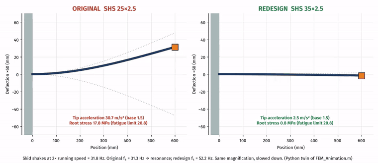
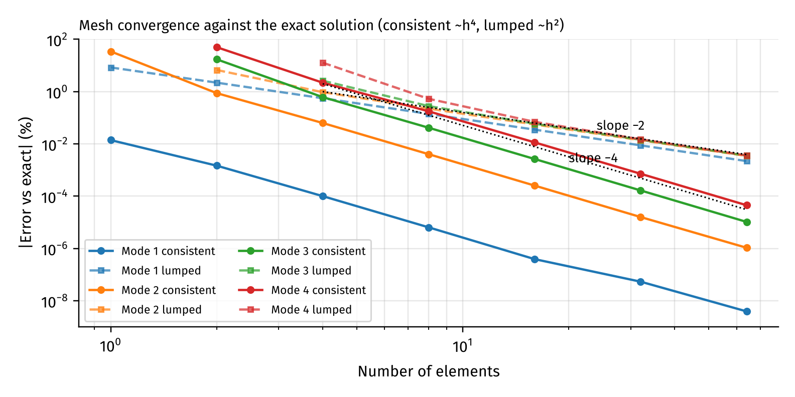
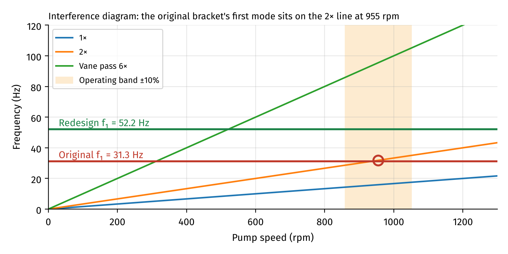
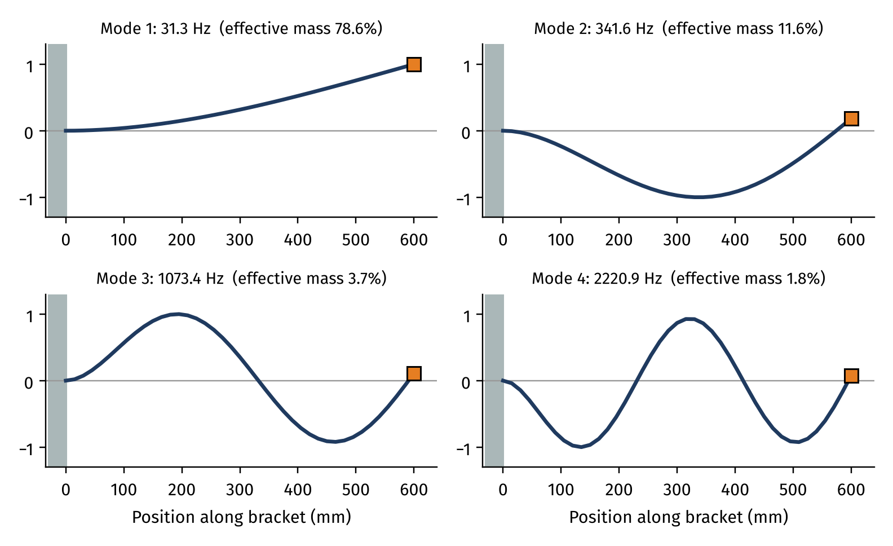
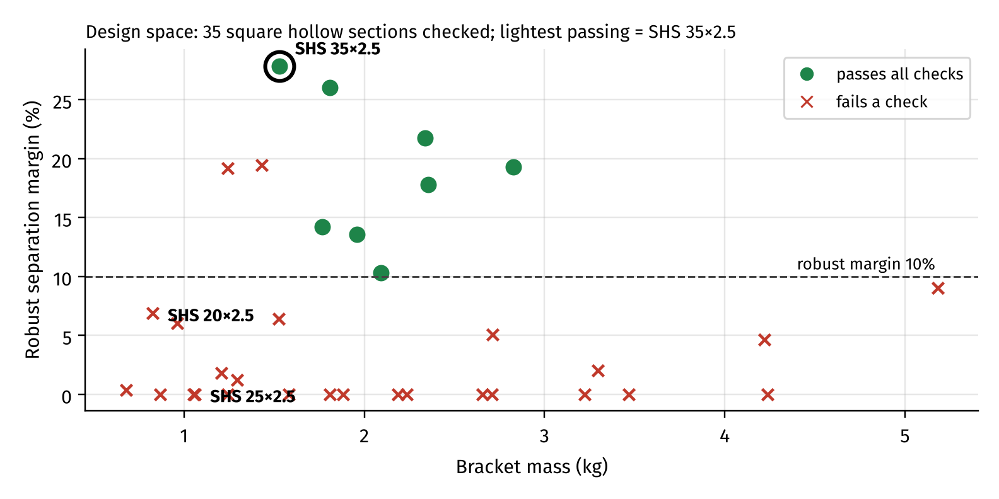
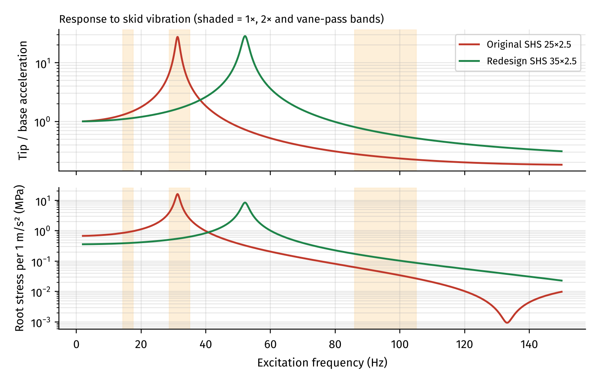
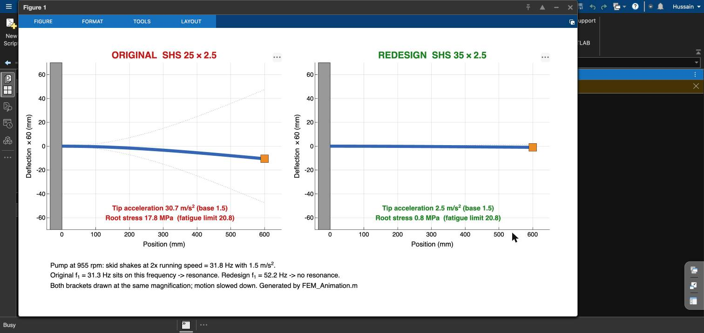

# Cantilever Bracket Modal Analysis with a Finite-Element Code Written from Scratch

**MATLAB · Finite Element Method · Modal Analysis · Forced Response · Fatigue · Robust Design**

A 0.6 m steel bracket (SHS 25×2.5) carries a 1.2 kg junction box on a 955 rpm pump skid, and its root weld **cracked**.

A beam finite-element program, written from scratch with its own **[K]** and **[M]** matrices, finds the cause: the bracket's first natural frequency (**31.3 Hz**) sits exactly on the pump's **2× running-speed vibration (31.8 Hz)**. The same program then selects a robust replacement.



📄 **Full 20-page report (PDF):** [`docs/FEM_Project_Report.pdf`](docs/FEM_Project_Report.pdf)

---

## Results

| | Original SHS 25×2.5 | Redesign SHS 35×2.5 |
|---|---|---|
| Mass | 1.06 kg | 1.53 kg |
| f₁ / f₂ | 31.3 / 342 Hz | 52.2 / 500 Hz |
| Separation margin, nominal / robust | 0 % / 0 % | **39.3 % / 27.9 %** |
| Worst weld stress in the speed band (fatigue limit 20.8 MPa) | **24.5 MPa – FAIL** | **1.33 MPa – PASS** |
| Worst junction-box acceleration | 42.3 m/s² | 4.5 m/s² |

## 1. The FE code is verified before it is used

| Check | Result |
|---|---|
| Natural frequencies vs exact cantilever-with-tip-mass theory | max error **0.0004 %** |
| Static tip deflection vs L³/3EI | identical to 7 digits |
| Mesh convergence, consistent mass | order **4.0** (theory: 4) |
| Mesh convergence, lumped mass | order **2.0** (theory: 2) |
| Independent Python re-implementation | all numbers agree |



## 2. The diagnosis: resonance with 2× running speed




At 2× running speed the junction box shakes about **20 times harder** than the skid. In the worst case within the speed band, the weld stress (24.5 MPa) exceeds the IIW FAT 71 fatigue limit (20.8 MPa).

## 3. Robust redesign across 35 standard sections

Every section must meet four criteria:

- **≥ 20 % frequency separation** from the 1×, 2× and vane-pass bands
- **≥ 10 % separation in the worst case** when stiffness is ±15 % and payload is ±20 %
- **Stress ≤ 50 % of the fatigue limit**
- **Practical limits** on wall thickness and deflection



- **SHS 20×2.5** is lighter and passes the nominal check, but **fails** the robustness check (6.9 %).
- **SHS 50×3** is stiffer, but its first mode lands **in** the vane-pass band.
- **SHS 35×2.5** passes every criterion with a large margin.



## Repository structure

```
matlab/
  beamFE.m            element matrices + assembly (Euler-Bernoulli, Hermite, consistent/lumped mass)
  exactCantilever.m   exact frequency equation of a cantilever with tip mass
  FEM_Main.m          Phases 1-6: problem, verification, modes, forced response, redesign, final check
  FEM_Animation.m     animated mode shapes and forced response (GIF)
  FEM_Experiment.m    steel-ruler + phone validation rig and FFT processing
figures/              result figures
animation/            animations + screenshots of MATLAB Online running them
docs/                 full PDF report + MATLAB Online screenshots
python/               independent re-implementation used to cross-check every number
```

## How to run

```matlab
cd matlab
FEM_Main         % prints all phases, saves figures/ and FEM_results.mat (about 40 s)
FEM_Animation    % animated GIFs (about 3 min in MATLAB Online)
FEM_Experiment   % predicts ruler frequencies; uses a demo signal until ruler_tap.csv exists
```

Only base MATLAB is needed (`eig`, `fzero`). All scripts were run in **MATLAB Online on 22 Nov 2026**; see [`docs/screenshots`](docs/screenshots).



The GIFs in `animation/` were rendered from the same equations by `python/render_figures.py`. MATLAB's own GIFs are produced by `FEM_Animation.m`.

## Honest scope

- This is a **representative case study**. The bracket, payload and skid vibration levels are realistic but assumed.
- The beams use Euler-Bernoulli theory and model vertical bending only. Next steps are listed in the report: a Timoshenko element, torsion, and a measured skid spectrum.
- A **steel-ruler tap test** is fully scripted (predicted 3.17 / 58.1 Hz with a 190 g phone at the tip). **No measured data has been reported yet.**

Companion project: [Robust Dynamic Vibration Absorber](https://github.com/Hussain-dev-pro/robust-dynamic-vibration-absorber) (same pump).

---

**Author:** Hameed Hussain · Licence: MIT
